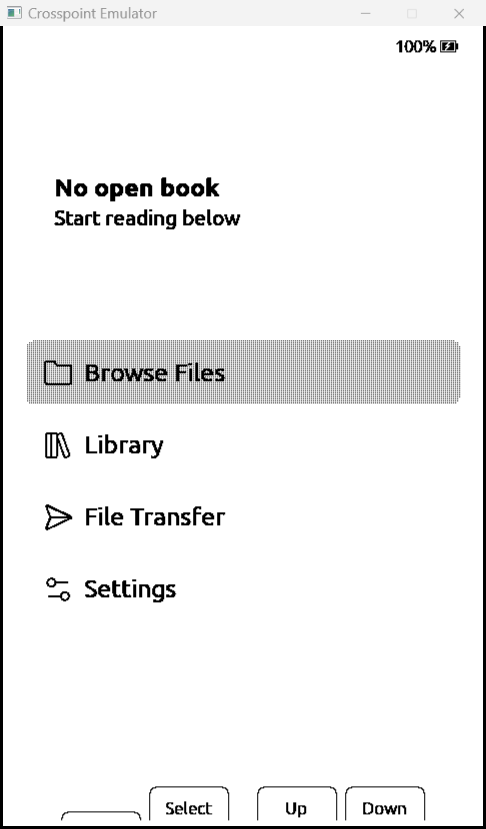

# Crosspoint for Windows — 模拟器 + 固件（2.x 分支）

在 Windows 上用 SDL2 窗口运行 [Crosspoint](https://github.com/crosspoint-reader/crosspoint-reader)
电子书固件，不需要真机、不需要烧录。

> **这是 `latest-firmware` 分支**：固件跟到上游 **HEAD（2026‑11‑21，`ca1a8c1`）**，
> 用上游移植 PR #6 的新模拟器内核（C++20、直接复用固件 HAL、FreeInk SDK）。
> `main` 分支仍保留原版模拟器 + 1.0.0 固件，那套更老但链路完全稳定。

📖 **完整产品说明、工作原理、以及「与原版固件的逐项差异」→ [docs/PRODUCT.md](docs/PRODUCT.md)**



## 30 秒跑起来

需要 Windows 10/11 x64、Python 3（工具链自带）、Git、网络（首次拉工具链和图片解码库）。

```bat
git clone --recursive -b latest-firmware https://github.com/Dingjinjin-chihiro/crosspoint-win.git
cd crosspoint-win

setup_toolchain.cmd   :: 首次：便携 MSYS2 + GCC / CMake / Ninja / SDL2 / Python（约 5 分钟）
build.cmd             :: 拉子模块（含 freeink-sdk）→ CMake 拉解码库 → 编译
run_emulator.cmd      :: 启动
```

首次 `build.cmd` 的 CMake 阶段会从 GitHub 取 PNGdec / JPEGDEC / AnimatedGIF（约 25 MB），
ArduinoJson 已内置在 `third_party/`，不需要下载。

## 按键

| 按键 | 功能 |
|------|------|
| ← ↑ → ↓ | 四向导航 |
| Enter | 确认 / 打开 |
| Backspace 或 Esc | 返回 |
| P | 电源键 |

## 调试

这是**能调源码的模拟器**，不是只能看的 demo：

- **gdb 断点/单步/调用栈**：用 `RelWithDebInfo` 编一份 `build-debug`，可直接 `break FileBrowserActivity::activateSelected`、看 `path` 参数、`bt` 出完整调用链（实测命中）
- **固件分级日志**：`[millis] [LEVEL] [MODULE] message` 直接走 stdout（已加 `fflush`，重定向到文件不会丢）
- **面板级截图**：运行中 `Ctrl+S` 写 `screenshots/*.bmp`
- **脚本化按键**：`scripts/upgrade_nav.ps1` 用 `PostMessage` 注入方向/确认键，可做回归

细节、命令和**局限性**（网络是桩、内存数字是假的、没有面板时序）见 [docs/DEBUGGING.md](docs/DEBUGGING.md)。

## 放书

`.epub` / `.txt` / `.xtc` 放进 `sdcard/`，重启后在 **Browse Files** 里可见。
仓库自带两本示例书。

## 这个版本带来了什么

相比 `main` 分支的 1.0.0，2.x 固件在模拟器里已经能看到：

- 新首页（继续阅读块 + 带图标的 Browse Files / Library / File Transfer / Settings）
- 文件列表显示扩展名与图标
- 阅读菜单扩展：书签、摘录剪贴（Clipping）、夜间模式、自动翻页、截图、二维码分享、阅读方向、文本设置
- 进度显示更细（章节 × 页数 + 百分比）

网络相关（Wi‑Fi / OPDS / 插件 / OTA）在模拟器里是桩实现，按设计不工作。

## 与 main 分支的差异

| | `main` | `latest-firmware`（本分支） |
|---|---|---|
| 固件 | tag `1.0.0`（2026‑02‑08） | **`ca1a8c1`（2026‑11‑21，主干 HEAD）** |
| 模拟器内核 | 原版（2026‑02‑11，自维护 sim HAL 头文件） | 上游 PR #6 的移植版（直接复用固件 HAL + FreeInk SDK） |
| 语言标准 | C++17 | C++20 |
| 固件补丁 | 2 个（cstdint、use‑after-free） | 不需要（上游已修复） |
| 额外依赖 | 无 | FreeInk SDK + PNGdec / JPEGDEC / AnimatedGIF |

`Crosspoint` 子模块指向我们自己的 fork 的分支 `emulator-latest`（内容等于上游 `c9cb1f8d`）。

## 已验证

首页 · 文件浏览 · **EPUB 阅读**（章节标题、两端对齐、1/2 22% 进度）· 翻页到下一章 · 阅读菜单 · 返回，
均在本机实测通过，无崩溃。

## 关于"最新"

本分支现在跟的就是上游主干 HEAD（`ca1a8c1`，2026‑11‑21）。为了让模拟器跟上 11 月这轮 HAL 变更，
sim 层做了这些适配：

- `HalDisplay` 接口对齐 HEAD：去掉 `drawImageTransparent` / `refreshDisplay` / `copyGrayscaleBuffers` /
  `toggleInverted` 等，新增 `controllerIdle()`，`getController()` 不再依赖未编译的 `BoardConfig::ACTIVE`
- `EInkDisplay` 补上 `getControllerName` / `getPanelName` / `setReaderRefresh` / `setOverlayFullTone` /
  `displayRetainedGrayscaleOverlay`
- `SDCardManager` 增加 `sdTotalBytes()` / `sdUsedBytes()`（存储信息页要用）
- `HalPowerManager::readBatteryPercentage()`（HEAD 新增的“取一次新鲜读数”）
- `freeink::hostResolves()`（SecureNet 的 DNS 预检，模拟器永远返回 false）
- `mbedtls/sha256.h` 换成真正的 SHA‑256 实现（书签 sync id 依赖它稳定）

升级方式：`git -C Crosspoint fetch origin ca1a8c1 && git -C Crosspoint checkout ca1a8c1`，重跑 `build.cmd`。

## 许可

模拟器（原版与移植版）与固件均为 MIT，FreeInk SDK 及其依赖见各自 LICENSE。原始版权见 `NOTICE`。
